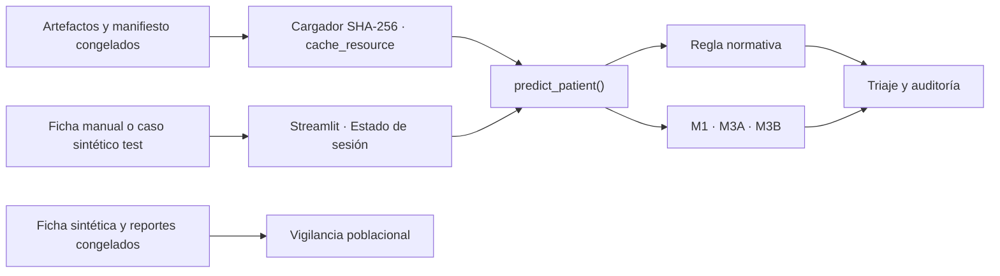

# Arquitectura del MVP de vigilancia de mercurio

## 1. Gobernanza de datos

El simulador exporta la ficha y las matrices con una clave `row_id` común. La cohorte tiene 1.500 registros con semilla 42 y particiones fijas de 1.050/225/225. La aplicación verifica SHA-256 de la ficha y del manifiesto de particiones contra el manifiesto del backend. Para los casos de demostración, la unión por ID usa exclusivamente `row_id` y `split` del archivo restringido. La selección se limita a `test`, usa atributos declarados y, para el caso de discordancia, usa el puntaje congelado de M3B. Las etiquetas de anomalía y variables latentes quedan fuera de la interfaz y de sus predictores. [Auditoría](../reports/data_audit.json) · [Esquema](../config/schema.json)

## 2. Motor normativo Guía Técnica N.º 537

El motor valida rangos, fechas y unidades. Para Probable requiere criterio epidemiológico y compatibilidad clínica documentada. Para Confirmado requiere además sangre validada >20 µg/L y orina validada >50 µg/g, conforme a §15.2, p. 36 y a la implementación del extremo superior de referencia sanguínea del Cuadro 3, p. 32. Sospechoso es un estado operativo de evaluación pendiente. El motor calcula EDI con los insumos declarados, registra prioridades y devuelve orientación sobre la matriz. La interfaz solo presenta esos resultados y registra la validación declarada por el profesional. [Reglas y trazabilidad documental](../config/normative_rules.json)

## 3. Motores analíticos

| Rama | Datos y operación | Resultado mostrado |
|---|---|---|
| M1 | `PRELAB_ALLOWLIST` y derivadas prelaboratorio. LightGBM conserva faltantes. Probabilidades y alertas publicadas respetan el orden de los cortes anidados. | Cinco probabilidades con sus umbrales, aviso experimental y seis contribuciones SHAP en log-odds de cada modelo independiente. |
| M3A | Gower con pesos 0,55/0,30/0,15 y cobertura mínima de 0,50. HDBSCAN fija los perfiles en entrenamiento. | Perfil asignado por distancia mínima al medoide dentro de su radio P₉₀, o estado atípico. |
| M3B | Isolation Forest ajustado con registros elegibles de entrenamiento. Usa logs, residuales, cuatro señales de discordancia y metadatos. | Puntaje y alerta preanalítica calibrada en validación, cuando existe al menos una medición válida en la escala del modelo. |

`transform_record()` comparte el contrato entre ajuste e inferencia. La interfaz usa ese mismo transformador para exponer las señales de M3B en fichas válidas. Las imputaciones internas de M3B forman parte del vector del modelo. El valor ausente de una medición en la ficha sigue siendo ausente. [Ingeniería de características](../src/features_pipeline.py) · [Evaluación congelada](../src/README.md)

## 4. Inferencia y presentación

Streamlit llama al cargador del backend antes de habilitar la evaluación. El cargador verifica código, configuración, artefactos y umbrales. La huella del manifiesto identifica la copia usada en la sesión. La integridad depende de la procedencia confiable del manifiesto y de los archivos `.joblib`. La aplicación lee los reportes directamente y no ejecuta entrenamiento. [Aplicación](../app/app.py) · [Manifiesto](../models/manifest.json)

| Hito del Plan Maestro | Evidencia |
|---|---|
| Reutilizar el backend congelado | Carga cacheada con prueba de rechazo de un artefacto modificado. |
| Operar las tres pestañas | Triaje, auditoría y vigilancia consumen el contrato v2 y los reportes. |
| Verificar cinco escenarios | Pruebas de Sospechoso, Probable, Confirmado, paciente sin laboratorio y caso de discordancia. |

La cohorte es sintética y de tamaño limitado. En prueba M1 detectó 8/11 positivos para el objetivo urinario Guía 537. No hay modelo de cordón por falta de mediciones. M3A asignó 106/225 fichas reservadas y sus perfiles carecen de validación clínica externa. M3B detectó 9/11 anomalías inyectadas en prueba y produjo 26 falsas alertas. Esos resultados se circunscriben al simulador. [Pruebas de interfaz](../tests/test_app.py) · [Métricas M1](../reports/metrics_m1.csv) · [Métricas M3A](../reports/metrics_m3a.json) · [Métricas M3B](../reports/metrics_m3b.json)
